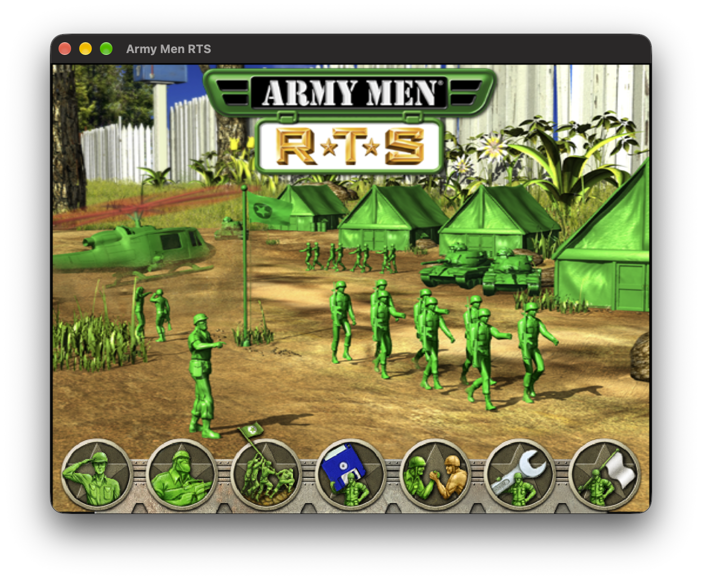
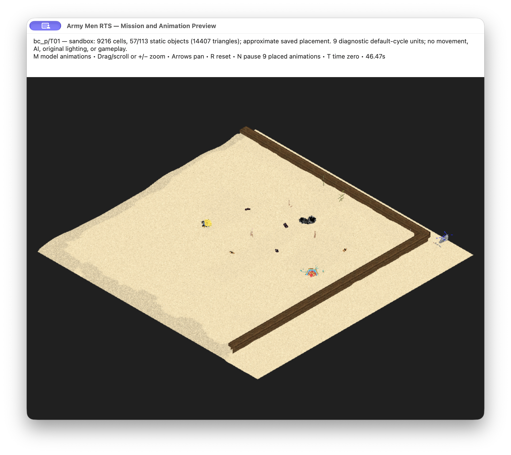
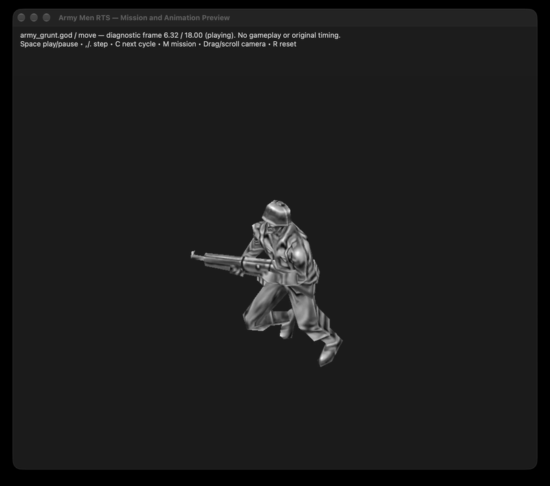

It's been fun watching Steve Troughton-Smith explore decompilation and porting using AI tools lately, and I've been getting more and more curious. His latest post was about someone who decompiled the original Mac version of SimCity 2000 and ported it to iPad, with smooth panning and zooming. It inspired me to try something similar.

  <iframe src="https://mastodon.social/@stroughtonsmith/117616643191502309/embed" class="mastodon-embed" style="max-width: 100%; border: 0" width="500" height="420" allowfullscreen="allowfullscreen" title="Post by Steve Troughton-Smith on Mastodon"></iframe>

## Where I started

After thinking of an old game I used to enjoy and doing a bit of research, I wanted to contribute to the [Spore decompilation project](https://github.com/NoahBPeterson/spore-decomp). The problem is I couldn't find my old copy of Spore, so that was a dead end, unless I wanted to buy it on Steam or GOG for $20 or $30 for a combo. For a project I was unsure of, I chose not to right now. I'll check in on the GitHub project in a few weeks and see where they're at.

Then I was out on a walk, still thinking about it. I couldn't think of the name of this old army game at first, but when I got home, a quick ChatGPT search found it in an instant: [Army Men RTS](https://www.gog.com/en/game/army_men_rts).

It came out in 2002, so it seemed like a good candidate, being so old and relatively small. It also seemed like a fun place to start. For reference, here are the minimum system requirements:

- **System:** Windows XP / Vista / 7 / 8 / 10
- **Processor:** 1.4 GHz
- **Memory:** 512 MB RAM
- **Graphics:** 3D graphics card compatible with DirectX 9.0

## Where it is now

I've had Codex working on it for a few hours, and this is how far it's gotten. The goal is to rebuild the game so it runs as a native Mac app. You bring your own copy of the game, so none of the original files are included. I got mine from [GOG](https://www.gog.com) for $6.

The first milestone was the main menu. It's the original presentation running in a native macOS window, with the hover and pressed button states working.

Next came a preview of the first Boot Camp mission. It draws the terrain and the objects placed on the map, rendered with Metal. There's no movement or gameplay yet, but you can pan around and zoom.

The units are starting to come to life too. This is a grunt, loaded from the original model data and posed with the animations recovered from the game.

## Ideas for later

The first goal is getting the original game running natively on the Mac, and nothing here is a promise. But I've been keeping a list of ideas for after that works:

- **Army colors:** Probably the most contained change. First I need to understand how the game handles team colors, then I can choose between a simple tint and something more precise. A color setting could build on that.
- **Better graphics:** Higher resolutions, Retina support, texture filtering, antialiasing, a sharper UI, and replacement textures are all fairly bounded upgrades. New models, lighting, shadows, and effects would be a much bigger art and rendering project. Either way, I want to keep a reference of how the original looks first, so I can tell an intentional change from a porting bug.
- **iPad:** Much of the game logic and file reading could be reused, but touch controls, camera movement, building placement, and performance are real work.
- **Swift or Rust:** For now it's a C++ engine with a thin layer for Apple's frameworks. Individual pieces could move to Swift or Rust later. It's not really necessary, but it may be fun.
- **Metal:** The previews above already use it. Down the road it could enable higher-resolution rendering, antialiasing, and shader-based team colors.

## What's next

I'm excited to see it finish. Once it does, I want to start messing around with it and really learn more about the game mechanics themselves.

I'll write more as it progresses.
