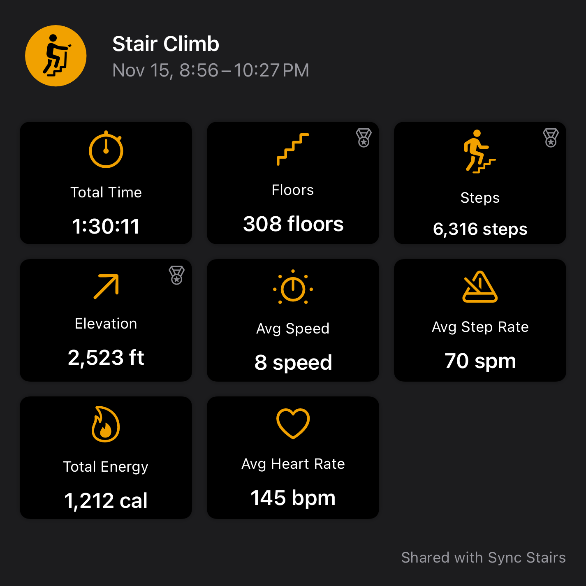

## Where it started

I've been working on [Bank Bonus Tracker](https://bankbonusapp.com), and the latest thing was a share card. After you get a bonus paid, the app now offers a card you can share, and it shows up alongside the confetti the app already had.

<div style="display: flex; justify-content: center;">
  <video src="/videos/emitter-behaviors/share-card-dev.mp4" controls muted playsinline loop style="max-width: 300px; width: 100%; border-radius: 12px;"></video>
</div>

I sent a screen recording of it to a friend who's new to iOS. They had a bunch of questions, so I started explaining how it all worked.

## The idea

Later that night I was on the stair climber, using [**Sync Stairs**](/sync-stairs), when I started thinking about confetti. Somewhere along the way, that turned into an idea for a small Swift package, and I spent the rest of the climb working through it in my head.[^records]

An hour later, Claude and I had [EmitterBehaviors](https://github.com/Rspoon3/EmitterBehaviors).

## What it is

EmitterBehaviors is a friendly Swift API for `CAEmitterBehavior`, the private Core Animation class behind iMessage confetti.

There's no public header for it and no documentation. It's all strings and key-value coding, so I leaned on two great write-ups by Bryce Bostwick, [CAEmitterBehavior](https://bryce.co/caemitterbehavior/) and [Recreating iMessage Confetti](https://bryce.co/recreating-imessage-confetti/). I also asked the runtime itself what it supports, which turned up a few behavior types and parameters that those posts don't cover.

Each kind of behavior is its own Swift class, configured the same way you'd configure a `CAEmitterCell`:

```swift
let sway = WaveBehavior()
sway.force = [100, 0, 0]
sway.frequency = 0.5

let attractor = AttractorBehavior()
attractor.stiffness = 5
attractor.radius = 300
attractor.falloff = -290          // negative repels

layer.emitterBehaviors = [sway, attractor, DragBehavior()]

// Animate a parameter with a compiler-checked key path. No strings.
let relax = CABasicAnimation(keyPath: attractor.keyPath(for: \.stiffness))
```

A few things I like about how it came out:

- **Behaviors are live.** Change a property after you've attached it and the layer sees it.
- **`nil` means "use the system default".** Every property is optional, and setting one back to `nil` clears it.
- **It fails quietly.** The class is found by name at runtime. If an OS doesn't have it, the properties are harmless no-ops.
- **It's tested.** The tests compare the package against what the runtime reports, so if Apple changes something it fails loudly instead of quietly doing nothing.

There's also a full recreation of the iMessage confetti burst in the documentation, built with the package.

## Things worth knowing

- This is private API, so there's no promise from Apple that it keeps working, and it could be a problem for App Review.[^private-api] If you use it, I'd put it behind a flag or `#if DEBUG`.
- Four of the behaviors (the simple attractor, light, and the two "over distance" ones) do nothing until `falloff` is set to a large value, around 500. At `falloff` 0 they look exactly like they're turned off. That one took me a while to figure out.

## Try it

```swift
.package(url: "https://github.com/Rspoon3/EmitterBehaviors", exact: "1.0.0")
```

The code is at [github.com/Rspoon3/EmitterBehaviors](https://github.com/Rspoon3/EmitterBehaviors). Enjoy.

[^private-api]: That said, I use it in my own apps, and I know some pretty big apps that have used it for years without any issue. Just saying.
[^records]: I got so caught up in the idea that I ended up breaking a few personal records along the way.

    
