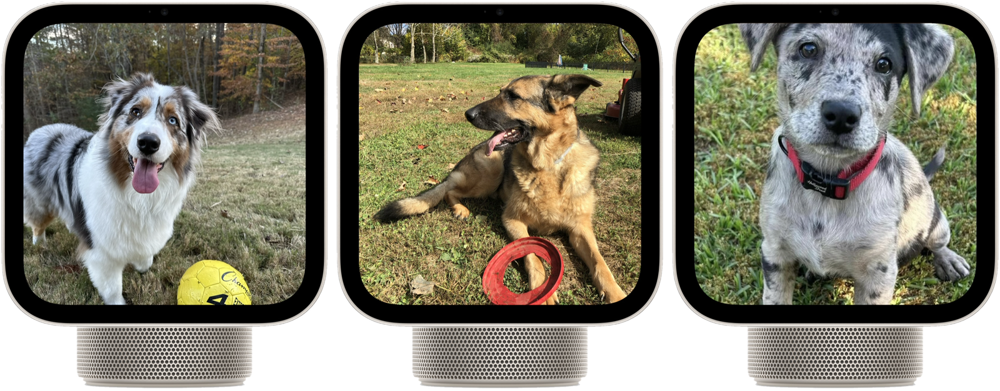
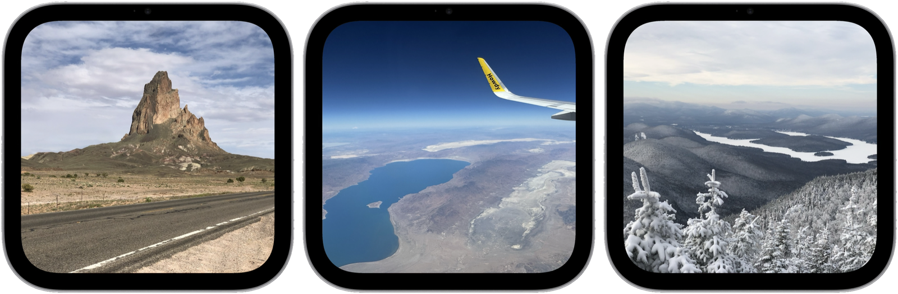

Apple's new HomeView is a square 7-inch smart display, and Apple hasn't published any design assets for it. There's no bezel, no template, and no device frame to download. There's no Xcode simulator for it either. I use [Shotbot](https://apps.apple.com/app/id6450552843) to put device frames around my screenshots, so I wanted it to handle HomeView screenshots too. I'm not aware of another app that does, which is probably because there was nothing to build it from.

## Making the frames

So I made them myself. I started from the product photos in Apple's newsroom, found the bezel in each one, rebuilt the aluminum rim, and cut the base out as its own piece. Then I scaled each screen opening to exactly 1088 × 1088, the HomeView's resolution, so a real screenshot drops in without any resizing. Every color and view draws the screen in the same spot, so switching between them never makes your screenshot jump around.

Using it takes no setup. Drop in a 1088 × 1088 screenshot and Shotbot recognizes it as a HomeView, since no other device uses that size. You can pick from all four colors Apple makes: Silver, Starlight, Rose Pink and Space Gray. You can also choose between With Base and Without Base, which is the wall-mounted model.

The wall-mounted model is a separate product, and Apple only sells it in Silver and Space Gray. So those are the only two colors with a Without Base option in Shotbot. If you're on Without Base and switch to Starlight or Rose Pink, it goes back to With Base instead of showing a frame for a device that doesn't exist.

## Getting a real screenshot

Apple doesn't offer a way to get screenshots off the device, and Xcode has no HomeView simulator. The community has gotten further than I expected, though. [Steve Troughton-Smith](https://mastodon.social/@stroughtonsmith) has been running HomeView's software in a virtual machine on his Mac, using a virtualized HomeView that [MacRumors](https://www.macrumors.com/2026/11/02/spotify-on-apple-homeview/) credits to Guilherme Rambo, and posting what he finds on Mastodon. His run-through of the OS is a screen capture at exactly 1088 × 1088, which is the size Shotbot looks for. He also got Spotify showing up on it through CarPlay.

  <iframe class="mastodon-embed" src="https://mastodon.social/@stroughtonsmith/117535714058540414/embed" style="max-width: 100%; border: 0;" width="400" height="560" allowfullscreen="allowfullscreen" title="Steve Troughton-Smith's run-through of the HomeView OS"></iframe>
  <iframe class="mastodon-embed" src="https://mastodon.social/@stroughtonsmith/117543062117057105/embed" style="max-width: 100%; border: 0;" width="400" height="560" allowfullscreen="allowfullscreen" title="Steve Troughton-Smith's post showing Spotify on HomeView"></iframe>

That's a full virtual machine, not a simulator, so it isn't something you can set up in a few minutes. There's an open-source project called [HomeView-VM](https://github.com/npwitk/HomeView-VM) that tries to boot HomeView's software on an Apple silicon Mac, but it's very much a research project. It needs macOS 27, changed security settings, and a lot of disk space, and its author says they haven't confirmed it reaches the home screen. Still, it means a real capture is possible, and anything captured that way is already 1088 × 1088, so it goes straight into Shotbot.

That still leaves plenty to do with it. The photo frame is the obvious one, since a HomeView on a shelf with your favorite photo on it looks great in a post, and that's what the images here are. It's also useful for mockups if you're designing a widget or app that might end up on the display, and a square screenshot in a device frame looks a lot better in a README or on an App Store page than a bare image.

Shotbot is on the [App Store](https://apps.apple.com/app/id6450552843).
